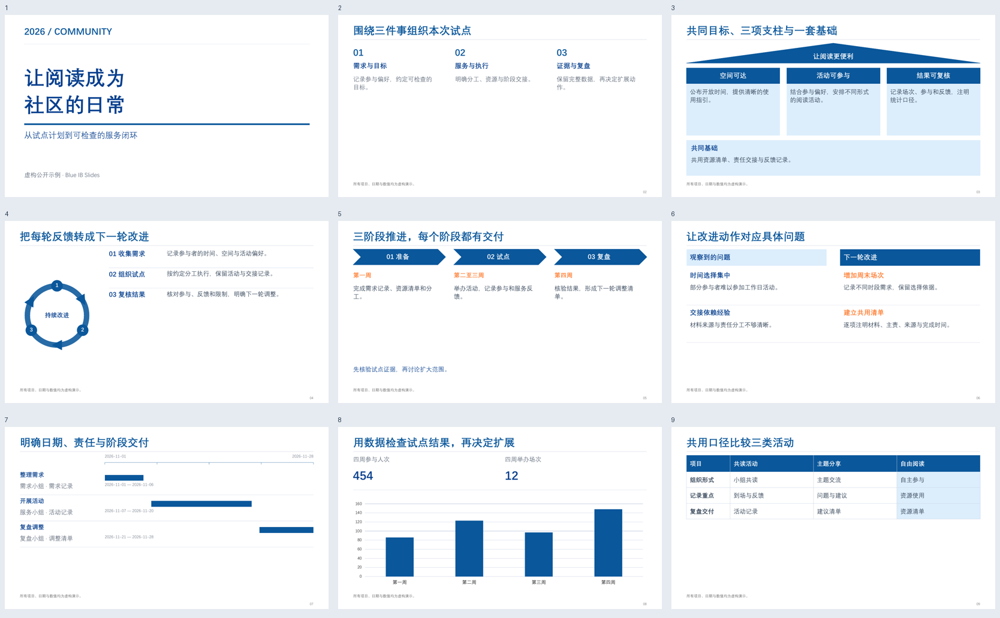

# blue-ib-slides

可编辑蓝调商务 PPT 技能，公开版 **4.3.0**，MIT 许可。默认蓝色标签、橙色动作词与清晰的图解关系；按真实文字测量选择版式、重排和拆页，保留事实及数值。



## 安装或升级

向 Codex 发送：

> 请安装 blue-ib-slides，地址是：https://github.com/south5721/blue-ib-slides 。如已安装，请先完整备份并保留我的定制，再升级。

也可从 [Releases](https://github.com/south5721/blue-ib-slides/releases/latest) 下载，将其中的 `blue-ib-slides` 文件夹放入个人技能目录，例如 `~/.codex/skills/`。替换旧版前先备份。安装后新建 Codex 会话，确保重新加载技能。

需要 **Node.js >=22、Python >=3.9**，以及系统中已有、允许使用的中文字体：

```sh
npm ci --ignore-scripts
npm test
npm run demo
npm run demo:editorial
```

字体文件不随包提供，也不会自动下载。可用 `BLUE_IB_FONT` 或 JSON 的 `font` 指定字体，用 `BLUE_IB_FONT_FILES` 注册本机已有字体路径（多路径用系统路径分隔符）。测量和实际 PowerPoint 渲染须使用同一字体。`BLUE_IB_NODE` 可指定已有 Node 运行时。

## 怎么使用

附上材料后，可直接发送：

> 请用 $blue-ib-slides，根据附件生成一份可编辑的蓝调商务汇报 PPT，面向管理层，预计 10 页。保留关键事实与数字；内容过密时重排或拆页，并检查实际 PPTX 渲染。

精修已有 PPT：

> 请用 $blue-ib-slides 精修附件，统一网格、留白、字阶和图表；保留事实与可编辑性，先备份原件。

参考指定风格：

> 请用 $blue-ib-slides 学习附件的布局、字阶和组件关系，主色保持蓝色。区分同内容复现与新内容迁移，展示实际渲染后的对照。

## 4.3 的能力

- 新增封面、目录、成对比较、原生比较表、按真实日期比例绘制的时间线，以及指标与图表组合页。
- 新增战略屋、闭环证据、阶段带三类原生可编辑图解；长内容按同级字号续页，保留完整文本校验记录。
- 延续并列模块、证据行、因果图、共同中心、双图与表格；原有 `designSystem: "blue-ib"` 输入保持可用。新输入默认 `blue-editorial`。
- 原生表格及真正的 PowerPoint Chart/XLSX 数据；核对图表缓存、内嵌工作簿、关系和命名空间，修复生成中的重复对象 ID；拒绝有动画引用时的歧义重编号。
- 只读 PPTX 结构、字体、分组几何盘点，以及选定页模板的未使用母版清理。盘点不能替代实际渲染。
- 可选本地 PPT Master 桥接：文档转换、PPTX 盘点、模板填充、静态 SVG 导出和备注/已有本地媒体增强。主生成器不依赖 PPT Master，不自动安装它、配置凭据或调用云端 TTS。

输入结构见 [schema](references/schema.md)，新页面见 [editorial.json](examples/editorial.json)，质量边界见 [QA](references/qa.md)。命令行构建：

```sh
python3 scripts/build-native.py examples/editorial.json out/editorial.pptx
python3 scripts/ppt-master-bridge.py --root /path/to/existing/ppt-master doctor
```

模板清理单独需要 requirements.txt 中的 lxml；文档转换和 SVG 路线另需已有 PPT Master 对应脚本及依赖，缺失会明确报错。其默认可编辑图表/表格可能只是形状；`svg-export --semantic-native` 要求上游确有语义原生导出选项。真正 Master/Layout 仅来自经过核验的模板路线，不能推及任意自由设计页。详见 [集成说明](references/ppt-master.md)。

## 验证和限制

生成时测量、选版、字号下限和拆页，与用户编辑后的 Office autofit 分开。输出采用 `noAutofit` 和有限空间预留；约 30% 预留只是估计，不保证任意增字都不溢出。超出后需重新生成或人工重排。

本发布的虚构样例与行为测试见 [验证记录](VALIDATION.md)。本轮目标客户端为 Mac PowerPoint 16.112；Windows PowerPoint、WPS 未验证。新生成文稿仍需在目标客户端检查整套缩略图和逐页渲染。XML/脚本通过不能代替视觉验收。

已知此 Mac/PPT Master 组合的 SVG 对象动画会导致空白渲染，桥接在 macOS 拒绝非 `none` 动画。默认静态汇报；音频生成和录播未验证。不会自动上传材料给外部服务。

公开版只含原创通用代码、可再分发依赖声明和虚构示例，不含个人训练文件、原始样稿截图、公司标识、商业数据或字体。它与本机内部定制包有素材和预设范围差异。

## 许可

原创代码采用 [MIT](LICENSE)，第三方依赖和集成见 [THIRD_PARTY_NOTICES.md](THIRD_PARTY_NOTICES.md)。输入文档、字体和媒体仍须有相应使用权；技能不转授第三方素材再分发权。
